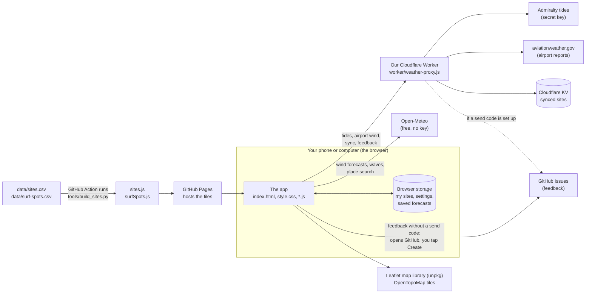

# How Sport Conditions works

The map of the app: what the parts are, how data flows between them, what
we rely on from outside, and where the weak spots are. Read this first to
understand the code. Claude updates it whenever the structure changes.

(The other documents: [SPEC.md](../SPEC.md) says *what* the app does,
[DESIGN.md](../DESIGN.md) how it looks, [STATUS.md](STATUS.md) where we are, [decisions.md](decisions.md) why
and why decisions were made, [CHANGELOG.md](../CHANGELOG.md) what changed when.)

## The big picture

**There's no server of our own and no database**: the app is a set of files
that run entirely in your browser. Everything it knows comes from free web
services, or from what's saved in that browser. The Worker is the one small
program we run, for the jobs a web page can't do itself (secret keys,
services that block web pages, and storing synced sites).

## What happens when you open the page

1. GitHub Pages sends the files; the browser runs the `<script>` files in the
   order `index.html` lists them. They all share one "global scope", so a
   name defined in one file (e.g. `state` in app.js) can be used in another.
2. `app.js` builds `state` (everything the app knows) from browser storage:
   your sites, the chosen sport and its settings.
3. If sync is on, it loads the latest sites from the Worker.
4. `refresh()` fetches, for each site of the current sport and all at once:
   the wind forecast (Open-Meteo); tides if it's on a beach (Worker →
   Admiralty, or Open-Meteo's tide model if that fails); waves if it's a
   surf spot (Open-Meteo Marine). Answers are kept in the browser for 30
   minutes, so reloading doesn't fetch them again.
5. `render()` draws the current tab. **Ratings are worked out while drawing,
   not when fetching**, so changing a setting re-colours everything at once
   without fetching again.

## How a rating is worked out

For every hour in the daylight window (`sun.js`), `checkHour` (weather.js)
runs a list of checks; each returns good / OK / no and a sentence saying
why. **The hour's rating is the worst of them.** The sentences are what the
hour details panel shows.

| Sport | Checks | Code |
|---|---|---|
| Parakiting | wind direction (site), wind speed (sport settings), rain, tide rule (site) | `weather.js` |
| Surfing | wave height in ft, swell period, swell direction (site), wind: offshore or light (site + settings), tide rule (site) | `surf.js` |

Rules about the **sport** (speeds, sizes) live in that sport's settings;
rules about the **site** (directions, tide rule) live on the site.

## The files

| File | Its job |
|---|---|
| `index.html` | The page's structure: tabs, panels, dialogs, and the list of script files |
| `style.css` | All the looks: design tokens (colours, sizes) for light and dark, then each part |
| `app.js` | The core: `state`, fetching, preparing hours (`siteDays`), drawing site cards, taps |
| `sports.js` | The sports list and `sportSites()` (your sites for the current sport) |
| `weather.js` | Wind forecasts from Open-Meteo, saving them for 30 min, the parakiting checks |
| `surf.js` | Surf settings, wave forecasts, surf checks, describing wave size, Surfline links |
| `tides.js` | Tides (Admiralty via the Worker, or a model), high/low water, tide rules |
| `sun.js` | Sunrise, sunset and twilight, for the daylight window |
| `units.js` | Wind speed units (mph, km/h, knots, m/s) |
| `storage.js` | Saving and loading in browser storage; per-sport settings; starter sites |
| `sync.js` | Syncing sites and settings between devices through the Worker |
| `overview.js` | The Overview tab: next good session, By day and By hour |
| `map.js` | The Map tab: pins, guide sites, the timeline |
| `details.js` | The hour details panel |
| `settings.js` | The Settings panel (sections per sport) |
| `sitesForm.js` | Adding and editing a site; compasses; tide rule; place search |
| `compass.js` | Drawing the 16-direction compass |
| `stations.js`, `windChart.js` | Live airport wind on the map, and its 24-hour chart |
| `windFlow.js` | The animated wind on the map |
| `tideChart.js` | The tide curve panel |
| `feedback.js` | Feedback mode: speaking notes and sending them to GitHub |
| `sites.js`, `surfSpots.js` | The site guides, **built** from `data/*.csv` (never edit by hand) |
| `worker/weather-proxy.js` | The Cloudflare Worker (deployed by Leo in Cloudflare) |
| `tools/build_sites.py` | Checks the CSVs for mistakes and builds the guides |
| `tools/preview.js` | Opens the app with made-up forecasts and saves a screenshot, for checking changes |
| `scripts/session.sh`, `.claude/settings.json` | Keeping phone and Mac sessions in step (the lock); counting messages so Claude suggests fresh sessions |
| `scripts/playbook-sync.sh`, `.claude/rules/playbook.md` | Leo's shared rules, copied from claude-playbook at each session start (don't edit here) |
| `.github/workflows/site-guide.yml` | Rebuilds the guides on GitHub when a CSV changes |

## What's stored where

| What | Where | Who can see it |
|---|---|---|
| Your sites, settings, chosen tab | Browser storage on each device | Only that browser |
| Saved forecasts (30 min) | Browser "Cache Storage" | Only that browser |
| Synced sites and settings | Cloudflare KV, under a long random code | Anyone with the code |
| Feedback notes | GitHub Issues (public repository) | **Everyone**: notes include where you were in the app, the time, screen size and browser name; nothing else about you |
| Secret keys (Admiralty, GitHub token) | Cloudflare Worker secrets | Only the Worker; never in the app's code |

## Outside services, limits and terms

| Service | Used for | Limits and terms |
|---|---|---|
| Open-Meteo | Wind, waves, place search, tide model, wind flow | Free; **10,000 calls a day per internet connection**, shared by Leo's devices; each place counts as one call |
| Admiralty (UK Hydrographic Office) | Official tide times | Free "Discovery" key, kept in the Worker |
| aviationweather.gov | Live airport wind | Free; blocks web pages, so it goes through the Worker |
| Cloudflare Workers + KV | The Worker, sync storage | Free tier |
| GitHub Pages, Actions, Issues | Hosting, rebuilding guides, feedback | Free for public repositories |
| Leaflet, OpenTopoMap | The map | Free; OpenTopoMap asks for light use and credit (shown on the map) |
| Surfline | **Linked only, not copied** | No public API; its terms forbid copying its forecasts |
| Flybubble | The parakiting site guide | Published here; permission still to be checked (STATUS.md) |

## Safety and security

- **No secrets in the app.** Keys live in the Worker as Cloudflare secrets.
- **The Worker isn't an open proxy:** it only makes the specific requests
  above, checks their inputs, and needs a send code to create issues.
- **Text people type is "escaped"** (`esc()` in app.js) before going into
  the page, so a site called `<script>` is shown as text, not run.
- **Links people type are checked:** a Surfline link must be a
  `https://www.surfline.com/` address (`isSurflineUrl` in surf.js).
- **Forecasts can be wrong.** Ratings are a guide from computer models, not
  a safety check; the hour details say why each rating was given.

## How changes are checked

- `node tools/preview.js` (see the top of the file) opens the app with
  made-up data at phone or desktop size, light or dark, reports page errors
  and saves a screenshot. It never uses the forecast service's daily limit.
- `python3 tools/build_sites.py` checks both site guides for mistakes.
- After pushing, the live site is checked on a phone.
- **Not yet:** automated tests of the rating rules (see "Weak spots").

## Weak spots (known, not yet fixed)

- **No automated tests** of the rating logic: a change could quietly
  re-colour hours wrongly. This is the next quality step to take.
- **Surf data is approximate:** spot locations and directions came from
  Claude's general knowledge (marked in `data/surf-spots.csv`), and wave
  heights are open-sea model heights, not breaking heights.
- **Map pins overlap** where spots are close (Newquay's town beaches) until
  you zoom in.
- **One shared global scope** for all script files: two files using the same
  name would clash (see the playbook's gotchas).
- `app.js` is the biggest file and does several jobs; it could be split.
