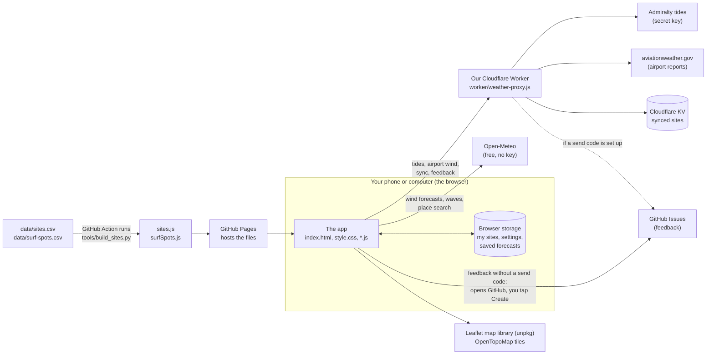

# How Sport Conditions works

A map of the app: what the parts are, how information moves between them,
what we rely on from outside, and where the weak spots are. Read this first
to understand the code. Claude updates it whenever the app's structure
changes.

(The other documents: [SPEC.md](../SPEC.md) says *what* the app does,
[DESIGN.md](../DESIGN.md) how it looks, [STATUS.md](STATUS.md) where we are,
[decisions.md](decisions.md) why decisions were made, and
[CHANGELOG.md](../CHANGELOG.md) what changed when.)

## The big picture

**We have no server of our own and no database.** The app is a set of files
that run entirely in your browser. Everything it knows comes from free web
services, or from what's saved in that browser.

The one small program we do run is the **Worker**: a few lines of code that
run on Cloudflare's servers, free. It does the jobs a web page can't do by
itself: using secret keys, reaching services that block web pages, and
storing synced sites.

Some other names in the picture:
- **GitHub Pages** hosts the app's files for free, straight from this project
  on GitHub.
- A **GitHub Action** is a small job GitHub runs for us when a file changes.
- **Cloudflare KV** is a simple online store the Worker uses for synced sites.
- **unpkg** is a free site that hosts code libraries, such as the Leaflet map.

## What happens when you open the page

1. GitHub Pages sends the files. The browser runs the `<script>` files (the
   app's code) in the order `index.html` lists them. They all share one
   "global scope": a name defined in one file (for example `state` in app.js)
   can be used in any other.
2. `app.js` builds `state` (everything the app knows) from browser storage:
   your sites, the chosen sport and its settings.
3. If sync is on, it loads the latest sites from the Worker.
4. `refresh()` fetches everything for each site of the current sport, all at
   once:
   - the wind forecast (Open-Meteo);
   - tides, if the site is on a beach (Worker → Admiralty, or Open-Meteo's
     tide model if that fails);
   - waves, if it's a surf spot (Open-Meteo Marine).

   The answers are kept in the browser for 30 minutes, so reloading the page
   doesn't fetch them again.
5. `render()` draws the current tab. **Ratings are worked out while drawing,
   not while fetching.** So changing a setting re-colours everything at once,
   without fetching again.

## How a rating is worked out

`sun.js` works out the daylight hours. For every one of them, `checkHour`
(in weather.js) runs a list of checks. Each check gives good, OK or no, and a
sentence saying why. **The hour's rating is the worst of them.** The hour
details panel shows those sentences.

| Sport | Checks | Code |
|---|---|---|
| Parakiting | wind direction (site), wind speed (sport settings), rain, tide rule (site) | `weather.js` |
| Surfing | wave height in ft, swell period, swell direction (site), wind: offshore or light (site + settings), tide rule (site) | `surf.js` |

Rules about the **sport** (speeds, wave sizes) live in that sport's settings.
Rules about the **site** (directions, tide rule) live on the site.

## The files

| File | Its job |
|---|---|
| `index.html` | The page's structure: tabs, panels, dialogs, and the list of script files |
| `style.css` | How everything looks: design tokens (named colours and sizes) for light and dark, then each part |
| `app.js` | The core: `state`, fetching, preparing the hours (`siteDays`), drawing site cards, handling taps |
| `sports.js` | The list of sports, and `sportSites()` (your sites for the current sport) |
| `weather.js` | Wind forecasts from Open-Meteo, keeping them for 30 min, and the parakiting checks |
| `surf.js` | Surf settings, wave forecasts, surf checks, words for wave size, Surfline links |
| `tides.js` | Tides (Admiralty through the Worker, or a model), high and low water, tide rules |
| `sun.js` | Sunrise, sunset and twilight, for the daylight hours |
| `units.js` | Wind speed units (mph, km/h, knots, m/s) |
| `storage.js` | Saving and loading in browser storage; settings for each sport; starter sites |
| `sync.js` | Syncing sites and settings between devices through the Worker |
| `overview.js` | The Overview tab: next good session, By day and By hour |
| `map.js` | The Map tab: pins, guide sites, the timeline, "show where I am" |
| `details.js` | The hour details panel |
| `settings.js` | The Settings panel (a section for each sport) |
| `sitesForm.js` | Adding and editing a site: compasses, tide rule, place search |
| `compass.js` | Drawing the 16-direction compass |
| `stations.js`, `windChart.js` | Live airport wind on the map, and its 24-hour chart |
| `windFlow.js` | The animated wind on the map |
| `tideChart.js` | The tide curve panel |
| `feedback.js` | Feedback mode: speaking notes and sending them to GitHub |
| `sites.js`, `surfSpots.js` | The site guides, **built** from `data/*.csv` (never edit them by hand) |
| `worker/weather-proxy.js` | The Cloudflare Worker (Leo puts it live in Cloudflare) |
| `tools/build_sites.py` | Checks the CSV files (spreadsheets) for mistakes and builds the guides |
| `tools/preview.js` | Opens the app with made-up forecasts and saves a screenshot, for checking changes |
| `scripts/session.sh`, `.claude/settings.json` | Keeping phone and Mac sessions in step (start-up sync, unfinished-branch list), noting when a conversation has grown costly (`COST:` lines), and checking docs before work is pushed to `main` |
| `scripts/playbook-sync.sh`, `.claude/rules/playbook.md` | Leo's shared rules, copied from claude-playbook at each session start (don't edit them here) |
| `.github/workflows/site-guide.yml` | The GitHub Action that rebuilds the guides when a CSV file changes |

## What's stored where

| What | Where | Who can see it |
|---|---|---|
| Your sites, settings, chosen tab, the map's three switches | Browser storage on each device | Only that browser |
| Saved forecasts (30 min) | The browser's "Cache Storage" | Only that browser |
| Synced sites and settings | Cloudflare KV, under a long random code | Anyone with the code |
| Feedback notes | GitHub Issues (public project) | **Everyone**. Notes include where you were in the app, the time, the screen size and the browser's name; nothing else about you |
| Secret keys (Admiralty, GitHub token) | Cloudflare Worker secrets | Only the Worker; never in the app's code |

## Outside services, limits and terms

| Service | Used for | Limits and terms |
|---|---|---|
| Open-Meteo | Wind, waves, place search, tide model, wind flow | Free. **10,000 calls a day per internet connection**, shared by Leo's devices. Each place counts as one call |
| Admiralty (UK Hydrographic Office) | Official tide times | Free "Discovery" key, kept in the Worker |
| aviationweather.gov | Live airport wind | Free, but it blocks web pages, so it goes through the Worker |
| Cloudflare Workers + KV | The Worker, sync storage | Free plan |
| GitHub Pages, Actions, Issues | Hosting, rebuilding guides, feedback | Free for public projects |
| Leaflet, OpenTopoMap | The map | Free. OpenTopoMap asks for light use and a credit (shown on the map) |
| Surfline | **Linked only, not copied** | No public API (no official way for apps to fetch its data); its terms forbid copying its forecasts |
| Flybubble | The parakiting site guide | Published here; we still need to check we have permission (STATUS.md) |

## Safety and security

- **No secrets in the app.** Keys live in the Worker as Cloudflare secrets.
- **The Worker isn't an "open proxy"** (a go-between anyone could use for any
  request). It only makes the specific requests above, checks what it's sent,
  and needs a send code before it creates issues.
- **Text people type is "escaped"** (`esc()` in app.js) before it goes into
  the page. So a site called `<script>` is shown as text, not run as code.
- **Your location** (the map's ◎ button) comes from the browser, only when
  you tap it. It's used to move the map and is never saved or sent anywhere.
- **Links people type are checked.** A Surfline link must start
  `https://www.surfline.com/` (`isSurflineUrl` in surf.js).
- **Forecasts can be wrong.** Ratings are a guide from computer forecasts, not
  a safety check. The hour details say why each rating was given.

## How changes are checked

- `node tools/preview.js` (instructions at the top of the file) opens the app
  with made-up data. It works at phone or desktop size, light or dark. It
  reports errors on the page and saves a screenshot. It never uses up the
  forecast service's daily limit.
- `python3 tools/build_sites.py` checks both site guides for mistakes.
- After each push, the live site is checked on a phone.
- **Not yet:** automated tests of the rating rules (see "Weak spots").

## Weak spots (known, not yet fixed)

- **No automated tests** of how ratings are worked out. A change could quietly
  colour hours wrongly. This is the next step for quality.
- **Surf data is rough.** Spot locations and directions came from Claude's
  general knowledge (marked in `data/surf-spots.csv`). Wave heights are
  open-sea computer forecasts, not the height of breaking waves.
- **Map pins overlap** where spots are close together (Newquay's town beaches)
  until you zoom in. Since 28 Oct, names that would overlap are hidden
  (`declutterLabels` in map.js) and good pins sit on top, but the pins
  themselves still pile up.
- **All script files share one global scope.** Two files using the same name
  would clash (see the playbook's gotchas).
- `app.js` is the biggest file and does several jobs. It could be split up.
