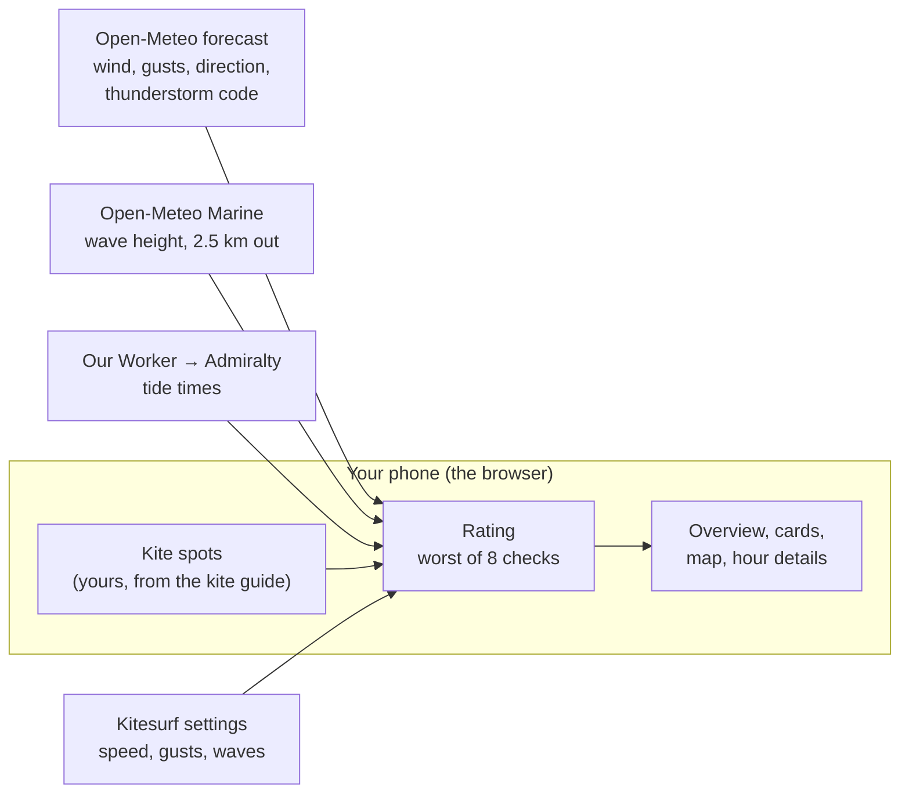

# Kitesurfing: a third sport

**Version 0.3 · 31 Oct 2026, UK time · Status: draft for Leo to decide on.
Not built yet.** Written with the playbook's "research to a document"
method. The build happens later, in a fresh session that reads CLAUDE.md,
docs/STATUS.md and this file.

## Summary

- **What:** add Kitesurfing as a third sport, next to Parakiting and
  Surfing. Every daylight hour at each kite spot gets 🟢 good, 🟡 OK or
  🔴 no, as the other sports do.
- **Why it should go better than surfing did:** surfing depends on the size
  of *breaking* waves, which free data can't give well. Kitesurfing depends
  mostly on **wind and tide**, and the app already gets both reliably. Waves
  matter less: we show the open-sea wave height (Open-Meteo Marine, the same
  free data surfing uses) and only rate it as "too big".
- **What's new compared with parakiting:** **gusts** (how much stronger
  than the average wind), **thunderstorms** (never kite in lightning),
  **waves too big** and **bans** (some beaches forbid kiting in summer).
  Plus a clear warning when the wind is **offshore** (blowing out to sea),
  the main danger in kitesurfing, and spots stay "OK at best" until you've
  checked them.
- **What's reused:** wind forecasts and the 5 forecast models, the wind
  direction compass, speed ranges, tides and tide rules, the wave forecast,
  the map, the Overview and the site form. That reuse is why this is a
  medium-sized job, not a big one.
- **How big:** a no-visible-change tidy-up (step 0), 3 build steps, a
  settings step, then your check on the live site. My
  estimate is 2 or 3 sessions (unverified: based on surfing, which took
  5 steps over about a day, 23 Oct in git). **Kitesurfing stays "coming
  soon" on the live site until steps 1–3 are all in** (wind, safety checks
  and waves), so you never see a kite rating with a check missing. Until
  then it opens only from a test link (`?sport=kitesurfing`).
- **One change to parakiting:** the thunderstorm check would apply there
  too (decision 9).
- **Next:** you answer the [decisions](#decisions-for-leo) below. Then a
  fresh session builds step 1.

## Plan and decisions

### How it works (the technology, in plain English)

1. **The app is a set of files that run in your browser.** There's no
   server of ours doing the work. GitHub Pages hosts the files for free.
2. **For each of your kite spots, the browser asks three free services:**
   - **Open-Meteo** (a free weather service) for the wind forecast: average
     speed, gusts and direction, each hour for 7 days. It's a computer
     forecast from one weather centre (a "model"); Met Office is the default.
     We'll also ask for its **weather code**, a number that says, among
     other things, "thunderstorm".
   - **Open-Meteo Marine** for wave height at a point about 2.5 km out to
     sea. This is the open-sea height, not the breaking wave at the beach.
     For kiting that's good enough: we only want to know "calm, choppy or
     big".
   - **Our Cloudflare Worker** (a tiny program of ours on Cloudflare's free
     servers) for official tide times from the Admiralty.
3. **The browser keeps the answers for 30 minutes**, so reloading doesn't
   ask again. That matters because Open-Meteo allows 10,000 calls a day per
   internet connection, shared by all your devices. Kitesurfing adds about
   2 calls per spot per refresh (wind, waves): 6 spots cost about 12 calls.
4. **Each hour is rated by 8 checks.** Each gives good, OK or no, and a
   sentence saying why. **The hour's rating is the worst of them**, as for
   the other sports. Ratings are worked out while drawing the screen, so
   changing a setting re-colours everything at once.
5. **Two kinds of rule** (the app's existing convention): rules about the
   **sport** (speeds, gusts, waves) are your settings, the same everywhere.
   Rules about the **spot** (which wind directions work, the tide rule) are
   set on each spot.

### Rating a kitesurf hour (the worst of these)

| Check | 🟢 Good | 🟡 OK | 🔴 No | Set in |
|---|---|---|---|---|
| Wind direction | the spot's good directions (usually cross-shore: along the beach) | the spot's OK directions (usually cross-onshore or onshore) | anything else. **Offshore** directions say so: "Offshore (E): blows you out to sea" | spot (wind compass + offshore compass) |
| Wind speed | 15–20 knots | 12–25 knots | outside OK | sport settings (asked the first time you open Kitesurfing) |
| Gusts ("gusts up to", the strongest in the hour) | up to 1.3 × the average (or within 5 knots) | up to 1.5 × (or within 8 knots) | more than that, or any gust over 30 knots | sport settings (new) |
| Thunderstorm | no thunderstorm forecast | the model can't forecast thunderstorms | thunderstorm forecast (weather code 95–99) | fixed, for safety (new) |
| Tide | outside the spot's tide window | – | inside it | spot (existing tide rules) |
| Waves (open-sea estimate) | up to the limit | – | over the limit (default 8 ft) | sport settings (new) |
| Restriction | – | – | inside a spot's ban (for example July and August, 10:00–18:00) | spot (new) |
| Checked spot | the spot is marked "checked" | the spot is still "unverified": **never better than OK** | – | spot (new) |

- **Rain doesn't count** (you're wet anyway). It's shown in the details.
- **Daylight hours** as for the other sports (Settings → Daylight).
- **If the chosen model can't forecast thunderstorms** (ECMWF can't), the
  check says "This model doesn't forecast thunderstorms: check another" and
  rates OK, not good. We never show "no thunderstorm" when we don't know.
- **Tidal streams aren't rated.** Gwithian's strong ebb current, for
  example, is only a note on the spot.
- The speed defaults are the common advice for an average rider on usual
  kites; you set your own the first time (decision 1). Kitesurfing defaults
  to **knots**, the unit kite advice uses (decision 4).
- The hour details end with one line: "A forecast, not advice: sea breezes
  and local effects change this."
- Gusts are a ratio of the average because a 6 mph gap is mild at 25 knots
  but rough at 12. The "within 5 knots" floor stops light winds failing on
  tiny gaps.

### The steps (each ends with something you can see)

| # | Step | You'll see | Status |
|---|---|---|---|
| 0 | **A small "sport registry"** (decision 6): each sport in sports.js says its checks, default settings, guide and words ("flyable", "rideable"). Today's `=== "surfing"` tests in those places use it instead. No visible change | Before and after screenshots identical (`preview.js`, both sports) | Not started |
| 1 | **Kitesurfing on a test link** (still "coming soon" in the menu), with a kite spot guide (`data/kite-spots.csv` → `kiteSpots.js`) and the checks the app already has: wind direction (with the offshore warning), wind speed, tide | On the test link: kite spots on the Overview, cards and map | Not started |
| 2 | **The new safety checks**: gusts, thunderstorms (fetching `weather_code`), bans, "unverified" spots capped at OK, the "forecast, not advice" line | On the test link: gusty, stormy or banned hours turn red, with the reason | Not started |
| 3 | **Waves**: fetch wave height for kite spots (reusing surf.js), show it in feet labelled "open-sea estimate", with plain words ("flat", "choppy", "big"), and the "too big" check. **Then Kitesurfing goes live in the menu**, with all 8 checks | Kitesurfing in the sport menu; wave height in the hour details and cards | Not started |
| 4 | **Settings and the site form**: kitesurf settings (speeds, gusts, wave limit); the spot form's wind and offshore compasses, tide rule and notes | You can change the rules and edit or add spots | Not started |
| 5 | **Leo tries it on the live site** and corrects the spots | – | Not started |

Each step: check with `node tools/preview.js` (made-up data), then
`node tools/ux-check.js` (must PASS, with Kitesurfing added to its list of
sports), then push and check the live site. Rating checks are plain
functions, so each new one is tested with `preview.js --eval` on made-up
hours (for example "gust 30, average 18 → no").

### Words used here

- **Cross-shore:** wind blowing along the beach. **Cross-onshore:** at an
  angle towards the beach. **Onshore / offshore:** straight towards the
  beach / out to sea.
- **Shorebreak:** waves breaking right on the sand, which make launching
  and landing a kite hard.
- **Model:** one weather centre's computer forecast (Met Office, ECMWF,
  ICON, GFS, AROME; the app lets you choose).
- **Weather code:** a number in the forecast for the kind of weather; 95–99
  mean thunderstorm.
- **Tidal stream:** the current the tide makes as it comes in and goes out.
- **Sport registry:** one list in the code that says, for each sport, what
  it checks and what it's called, instead of "if surfing … else …" spread
  across files.
- **CSV:** a spreadsheet saved as plain text; the spot guides are CSV files.
- `preview.js` and `ux-check.js`: the app's own check tools. The first opens
  the app with made-up forecasts; the second checks every screen against
  the design rules.

### Decisions for Leo

Each has my recommendation. Answer by number; "all as recommended" is fine.

1. **Your wind range.** It depends on your weight and kite sizes. *Recommend:*
   the app asks the first time you open Kitesurfing, pre-filled with good
   15–20 knots, OK 12–25 knots. Tell me your kites if you want better
   defaults. (Common advice; see Detail.)
2. **Gust rule.** *Recommend:* good up to 1.3 × the average (or within
   5 knots), OK up to 1.5 × (or within 8 knots), red for any gust over
   30 knots. All are settings. (Low confidence: no standard exists.)
3. **Waves.** *Recommend:* show wave height, and rate only "too big"
   (over 8 ft = red; shorebreak makes launching hard). A "flat water or
   waves" preference goes to Later.
4. **Units.** The app's convention is mph. *Recommend:* kitesurfing
   defaults to knots (each sport already has its own unit setting), because
   kite advice, kite charts and Windguru all use knots. (This spec is
   written in knots for that reason.) We'd record this as
   an exception in CLAUDE.md and decisions.md. Or: keep mph everywhere.
5. **Starter spots.** *Recommend:* start with the three spots where I found
   local club guidance (Watergate Bay, Perranporth / Perran Sands,
   Gwithian), "unverified" until you tick "checked". Hayle (The Bluff),
   Marazion and Daymer Bay join the guide only once you (or a club page we
   can read) give their directions; until then they're left out. Is there a
   spot you actually kite that's missing?
6. **Code tidy-up first?** About 28 places in 10 files say "if surfing …
   else …". The danger: with a third sport, anything that isn't "surfing"
   quietly behaves like parakiting (for example the words "Nothing
   flyable"). *Recommend:* step 0, a thin "sport registry" for checks,
   settings, guide and words only, tested by identical before and after
   screenshots. The forms change in step 4. It's about a third of a session
   (my estimate) and lowers the risk of the rest.
7. **Bans and permits** (Daymer Bay: no kiting July and August,
   10:00–18:00; The Bluff: a permit). *Recommend:* a ban is a legal limit,
   so rate banned hours red (a simple dates-and-hours rule on the spot, in
   step 2). Permits stay a note on the spot card.
8. **"Unverified" spots never show green.** *Recommend:* yes. The starter
   spots' directions are from web guides, and a wrong offshore compass could
   show a dangerous hour as good. You tick "checked" on each spot once you've
   confirmed it.
9. **Thunderstorm check for parakiting too?** It's a safety rule for any
   kite. *Recommend:* yes, in step 2 (one more check on parakiting, same
   code).

### Later (not in this build)

- A kite size suggestion from your weight and the wind.
- Ocean currents (Open-Meteo has them, but on an 8 km grid: too coarse for
  a rip at one beach).
- A "flat water or waves" preference.
- Live wind stations near kite spots (the map's airport wind already helps).
- The overview across all sports (SPEC.md step 5) will include kitesurfing
  once it's built.

## Detail

### Where the rules came from (searched 31 Oct 2026)

Most sources are kite schools, shops and forums: guidelines, not standards.
Confidence: **medium** for speeds and directions (sources agree), **low**
for the gust numbers (no standard exists).

- **Speed:** usable wind is roughly 12–25 knots; 15–20 knots is the usual
  "sweet spot"; below about 12 knots is hard with normal kites
  ([Kiteworldwide](https://kiteworldwide.com/blog/2024/05/how-much-wind-do-i-need-to-learn-to-kitesurf/),
  [Northern Kites](https://www.northernkites.co.uk/blogs/blog/how-many-knots-for-kitesurfing),
  [Elite Watersports](https://elitewatersports.com/blogs/tips-and-tricks/kiteboarding-weather-conditions-how-much-wind-do-you-need)).
- **Direction:** cross-shore and cross-onshore are best. Straight onshore
  works but brings shorebreak and can drag you up the beach. Offshore and
  cross-offshore are dangerous (you drift out to sea), for experts with a
  boat only ([Peter's Kiteboarding handbook](https://kitesurfing-handbook.peterskiteboarding.com/wind/wind-directions),
  [Kernow Kitesurf Club](https://www.kernowkitesurfclub.co.uk/spot-guide)).
- **Gusts:** a spread of 3–5 knots over the average is normal; gusts more
  than about 25% above the average count as "gusty"; riders size their kite
  for the gusts ([Seabreeze forum](https://www.seabreeze.com.au/forums/Kitesurfing/Newbies-Tips-Tricks/What-amount-of-wind-Gust-is-ok),
  [MACkite](https://www.mackiteboarding.com/kitesurfing-safely-in-gusty-conditions.htm)).
- **Lightning:** "never fly a kite in a lightning storm" (a code of conduct
  a Cornish club gives its members, [Kernow Kitesurf Club](https://www.kernowkitesurfclub.co.uk/?p=31)).
- **How other apps rate:** Windguru's stars measure wind strength only.
  KiteReady rates wind strength against the spot's usable range for your
  level, direction against the real coastline, and gusts. It uses the same
  public models as Windguru and Windy and "interprets them", with local
  knowledge from kite schools
  ([interview, surf-magazin.de](https://www.surf-magazin.de/en/windsurfing/scene-and-events/wind-and-weather-the-spot-is-calling-interview-about-the-kiteready-app/)).
  Our plan is the same idea: speed (sport), direction (spot), gusts.

### Open-Meteo facts we rely on (from its docs, via search; to verify)

- Hourly `wind_gusts_10m` is the strongest gust **in the hour before**
  (ECMWF: the 3 hours before).
- `weather_code` 95 = thunderstorm, 96 and 99 = with hail (only models with
  a hail forecast, such as ICON and Met Office), 97 = heavy thunderstorm
  (some docs). **ECMWF can't forecast thunderstorms**; KNMI gives no codes
  for them. ([Open-Meteo docs](https://open-meteo.com/en/docs))
- Marine `wave_height` is the significant wave height of wind sea and swell
  together, in metres (we convert to feet). Currents and tides in the
  Marine API are on an ~8 km grid and "not suitable for coastal navigation"
  ([Marine API docs](https://open-meteo.com/en/docs/marine-weather-api)).
- **The app's wind reads 1–2 knots below Windy at the coast** (our 28 Oct
  check, docs/decisions.md). For kiting that errs on the safe side.

### Starter spots (from local guides; approximate, to check)

| Spot | Good wind | OK wind | Offshore (red, warned) | Tide rule | Notes |
|---|---|---|---|---|---|
| Watergate Bay | SW, WSW, N | W, NW, NNW | E, ESE, SE | not within 2 h of high water | No launching between lifeguard flags; use the north end in summer |
| Perranporth / Perran Sands | S, SSW, SW | WSW, W | E, ENE, ESE | not within 2 h of high water | Zoned: no kiting at high tide at the town end; Perran Sands end less gusty in a southerly |
| Gwithian | SW, NE | W, N | SE, SSE, S | only within 3 h of low water | Strong ebb current: "many competent sailors have been caught out" |
| Hayle (The Bluff), guide only | ? | ? | ? | ? | Needs a Bluff Pass from Kernow Kitesurf Club and third-party insurance |
| Marazion, guide only | ? | ? | ? | ? | Little data found |
| Daymer Bay, guide only | ? | ? | ? | ? | Banned July and August, 10:00–18:00 |

Directions come from [Kernow Kitesurf Club](https://www.kernowkitesurfclub.co.uk/spot-guide/gwithian/)
(Gwithian: SW and NE cross-shore, W and N cross-on, NW nearly onshore; 3–4 h
either side of low), [its Perranporth page](https://www.kernowkitesurfclub.co.uk/spot-guide/perranporth-perran-sands/),
[extremekites.org](https://extremekites.org/reviews/other/the-beach-watergate-bay-r902)
and [Adventure Sports Holidays](https://adventuresportsholidays.com/local-experts-guide-eight-best-cornwall-kite-beaches/).
Sources disagree in places (one says Gwithian is best at higher tides), so
every spot is marked "check and edit". Locations are set from the map in
step 1. We store our own short summary, never copied guide text.

### Parts involved

- `sports.js`: Kitesurfing (🪁 is already parakiting's; the icon is chosen
  in step 1) and the thin sport registry (step 0).
- New `kite.js`: kitesurf settings defaults, the gust, thunderstorm, ban,
  "checked" and wave-limit checks, `checkKiteHour`, starter spots. Reuses `checkDirection`
  and `checkSpeed` (weather.js), `checkTide` (tides.js) and `fetchWaves`
  (surf.js, without the surf size factor).
- `weather.js`: add `weather_code` to the hourly request (one word; saved
  forecasts refetch once).
- `app.js`, `overview.js`, `details.js`, `map.js`, `settings.js`,
  `sitesForm.js`, `storage.js`, `sync.js`: the places that ask "which
  sport?" (decision 6).
- `data/kite-spots.csv`, `tools/build_sites.py` (build and check it), the
  GitHub Action (`.github/workflows/site-guide.yml`, add the new CSV).
- `tools/ux-check.js`, `tools/preview.js`: add the sport.
- Map: kite spots show as pins like surf spots. **No rated guide layer**
  (the parakiting guide layer costs about 100 calls per map view).
- Docs, in the same commits: SPEC.md (a new "Version 1.4: Kitesurfing" section with these steps), ARCHITECTURE.md
  (sport table, files, services), DESIGN.md (any new component),
  CHANGELOG.md, decisions.md.

### Out of scope

- Kite size advice, seasonal bans as rules, currents, wave preference
  (Later, above).
- Copying any forecast or spot guide text. Windguru and Windfinder are not
  used (no free API for this; we'd only link to them, if you want).
- Any claim that a 🟢 hour is **safe**. The details panel keeps saying that
  ratings are a guide from computer forecasts.

### How we'll check it's done

- Each check gives the right rating for made-up hours (`preview.js --eval`):
  offshore → no with the warning; average 20 knots, gusts 28 → OK;
  gusts 31 knots → no;
  thunder code 95 → no; ECMWF chosen → "can't forecast thunderstorms", OK;
  waves 9 ft → no; inside the tide window → no; Daymer Bay at 12:00 on
  1 August → no; an unverified spot with perfect conditions → OK.
- Step 0: screenshots before and after match for parakiting and surfing.
- `node tools/ux-check.js` PASS for all three sports, phone and desktop,
  light and dark.
- `python3 tools/build_sites.py` accepts `data/kite-spots.csv`.
- Live site: Kitesurfing in the sport menu; a real forecast at Watergate
  Bay looks sensible against Windy (same model) for one day.
- Open-Meteo calls for a full kite refresh: about 2 per spot (check in the
  browser's network list once).

### Risks and open questions

- **Not verified in this session:** this session couldn't open web pages,
  only search. So the Open-Meteo facts above come from search summaries of
  its docs, and the spot details from summaries of the club's pages. Step 1
  must first fetch one real forecast (with `weather_code`) and one wave
  forecast for Watergate Bay and check the fields exist as described.
- **Gust numbers are the weakest part.** No standard exists; they're
  settings, so you can tune them after a few sessions.
- **Coastal wind is hard to forecast.** Models miss sea breezes and the
  sudden change from land to sea. A green hour can still be wrong.
- **Offshore wind is the big safety risk.** The offshore compass must be
  set right for each spot; a mistake could show a dangerous hour as OK.
  That's why spots start marked "check and edit", and why offshore is red
  with a warning, not just "doesn't work here".

## Change log
- 0.3 (31 Oct 2026): after a reader check: goes live after step 3, not 2;
  test examples in knots; a "words used here" list; guide-only spots left
  out until their directions are known.
- 0.2 (31 Oct 2026): after a fresh critic's review: kitesurfing hidden until
  the safety checks are in; gusts as a ratio; knots; bans rated; unverified
  spots capped at OK; thunder for parakiting; thin registry first; no guide
  map layer.
- 0.1 (31 Oct 2026): first draft from research; decisions open.
